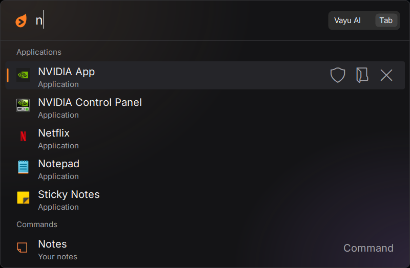
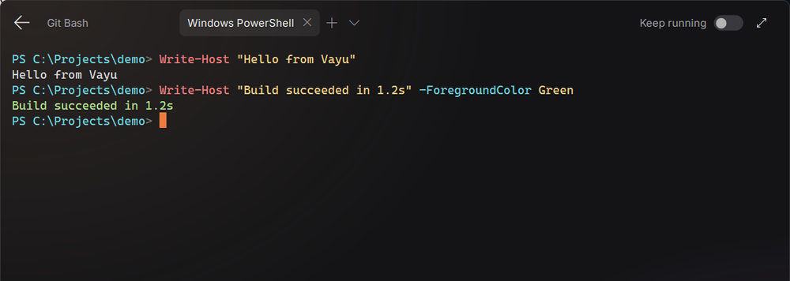

<h1 align="center"> Vayu</h1>

<b>A free, fastest command palette launcher application that works completely offline for Windows.</b>

  <a href="https://github.com/YashPatkar/vayu/releases/latest/download/vayu.exe"><b>Download for Windows</b></a> ·
  <a href="#why-people-switch">Why switch</a> ·
  <a href="#everything-it-does">Features</a> ·
  <a href="#side-by-side">Comparison</a> ·
  <a href="#privacy">Privacy</a>

---

Press a shortcut. Type a name or a whole sentence. It's done in a moment.

Vayu is a launcher like the ones you may already use, rebuilt from scratch to be **tiny, instant and
private**. One small file (about 6 MB). No account. No subscription. No internet needed. It sits at **0% CPU**
while you're not using it, and shows the window in about **50 milliseconds** after you press the key.

  
  &nbsp;
  

  

## Download

**[⬇ Download vayu.exe](https://github.com/YashPatkar/vayu/releases/latest/download/vayu.exe)** (about 6 MB)

1. Run it. There's no installer and no admin prompt. A short setup walks you through the rest.
2. Tap the **Windows key**. That's it. (Want another shortcut? Pick it in setup or in Settings.)

Works on Windows 10 and 11 (64-bit). Nothing else to install. It starts with Windows from then on and
updates itself.

## Why people switch

- **It's instant.** About 50 ms from your key press to the window drawn
  (measured on 23 November 2026 on a 144 Hz screen).
- **It's light.** A 6 MB download, about 60 MB of memory after a full day of use, and 0% CPU when idle.
  Others take hundreds of megabytes of disk and memory, and keep working in the background.
  Built with Rust: native code with no runtime, and memory safe by design.
- **It's free, really.** No paid plan, no "Pro" features, no trial that runs out. AI included, with your
  own key or a model on your own PC.
- **It's private.** Works offline. No account, no sign-in. Nothing you type ever leaves your PC
  unless you choose to use an online AI. Vayu only sends a few anonymous usage counts.
- **It understands you.** Type "open notion" and it opens the app, or the website if you don't have
  the app. Type a whole sentence and it does every step.

## Everything it does

### Find and open

- **Apps, settings, files and folders** in one box. Type a few letters; the right thing comes first.
- **It learns.** What you pick most comes first next time, for the exact words you typed.
- **Windows settings** with `!` ("!bluetooth", "!display"), **files and folders** with `/`.
- **Open anything by name.** An app if you have it, a website if you don't, a web search if it's
  neither. Never a dead end.
- **Websites in the browser you want.** "open youtube on brave", "open chatgpt using my work edge":
  even the right browser profile.
- **Your own sites.** Paste a link once; open it by a word from its address forever.
- **Recently used** at the top: reopen what you used last with one key press. Pick how many, or
  turn it off.
- **Run as administrator, open file location, or hide** a result, right from the list.
- **Clipboard history.** Type `#` to see what you copied lately: text and screenshots, newest
  first. Press Enter to paste one back, pin the ones you keep using. Anything a password manager
  marks as private is never saved, and nothing leaves your PC.

### Do more in one go

- **Sentences with several steps.** "open docker, then open my project in vs code". Vayu does each
  step in order. No AI needed for everyday sentences.
- **Hindi and Hinglish** typed in Devanagari work too.
- **A terminal in the box.** Start with `>` to run a command and see the output right there. Risky
  commands ask before running.
- **Calculator.** Type `24*8/16`, press Enter to copy the answer.
- **Quick notes** with `@`: jot something down without opening another app.

### AI, your way (optional)

- **Use an AI you already have.** Sign in once to the Claude or ChatGPT app on your PC and Vayu works
  with it: ask in the box, or open **Vayu AI** for a full chat.
- **Paste a screenshot** straight into Vayu AI (Ctrl+V) and ask about it.
- **Bring your own AI**: a key from any cloud provider (Anthropic, OpenAI, Groq, Gemini and more), or
  a **model running on your own PC** (Ollama, llama.cpp) with no internet at all.
- Your key goes straight from your PC to the provider you picked. No middleman, no markup, no
  subscription.
- AI only steps in for sentences the built-in rules can't read. Everything else stays offline.

### For power users: Developer mode

- **Your own commands**: give any command a short name and run it from the box.
- **Your own tools**: point Vayu at a folder, and your AI coding assistant can write new tools for it.
  Each tool asks once before it ever runs.
- **Pick your terminal**: Command Prompt, PowerShell, Git Bash, WSL, whatever you have.

### Made to stay out of your way

- **The Windows key opens Vayu.** Tap it by itself; Win plus another key still works as always.
  Prefer something else? Press the keys you want and save. No typing key names.
- **A guided first run.** Four short steps: what it does, connect an AI, and try your shortcut.
- **Starts with Windows**, ready when you log in. Turn it off any time. Want it even sooner? Start
  it as a Windows service, at top priority.
- **A clean settings window**: clear sections, switches, and a search box to find any setting.
- **Remembers what you typed** if you click away, so nothing is lost.
- **Updates itself**, and checks every update's digital signature before installing it.
- **Dark, clean and smooth**: crisp text, a soft glow, and no flicker while you type.

## Side by side

Measured on the same laptop (Intel Core i5-12450H, 16 GB RAM, Windows 11), all three running at the same time, on 18 November 2026.

| | **Vayu** | Raycast | PowerToys Run |
|---|---|---|---|
| Space on disk | **6 MB** | 565 MB | 851 MB (PowerToys) |
| Memory after real use | **60 MB** | 348 MB | 111 MB |
| Highest memory seen | **76 MB** | 428 MB | 278 MB |
| CPU while idle | **0.00%** | 0.63% | 0.26% |
| Key press → window drawn | **~50 ms** (23 Nov 2026) | not measured | not measured |
| Runs without an account | **Yes** | Sign-in for Pro features | Yes |
| AI without a paid plan | **Yes** (your key or a local model) | No (Pro plan) | No AI |
| Multi-step sentences | **Yes**, no AI needed | With paid AI | No |

*Memory is the working set reported by Windows; for Raycast and PowerToys Run it includes their helper
process (highest memory is the main process alone). Idle CPU is measured over 30 seconds with each launcher hidden. Your numbers will differ by PC.*

## Privacy

**What you type, search and open stays on your PC.** Vayu has no account and nothing to sign in to.

- **Offline by default.** Besides the usage counts below, only two things go online, and only if you
  use them: an online AI you set up yourself, and the update check (which sends nothing about you).
- **Your AI key** is kept in Windows Credential Manager, never in a plain file.
- **No admin rights.** Nothing is installed outside your own user folder.
- **Asks before risky steps**: closing an app, running a command the AI chose, or running a tool for
  the first time.

### Anonymous usage counts

Vayu sends a few anonymous counts so the author can see how many people use it and which features
are worth improving. This is always on.

- **Sent:** a random install id (not linked to you or your PC), the Vayu and Windows version, display
  scale and language, when Vayu was installed, started or updated, which setup pages were reached,
  and once a day how many times each kind of thing was opened (apps, files, folders, settings,
  commands, notes, web searches, sums, AI questions), only the numbers. If Vayu crashes, where in its
  code it happened, with paths removed.
- **Never sent:** anything you type or search, file names or paths, app names, AI questions or
  answers, notes, your user name, your computer's name, or hardware ids.
- **Where:** PostHog, on its servers in the European Union, with location lookup turned off.

Full details: [Privacy Policy](PRIVACY.md).

## Free to use

Vayu is free to download and use, at home or at work. This repo holds the app and its releases, not
the source code. See the [Terms of Use](TERMS.md) (use it anywhere: yes; resell or rebrand it: no).

## Feedback & issues

Found a bug or have an idea? [Open an issue](https://github.com/YashPatkar/vayu/issues).

If something breaks and you'd rather not post it publicly, email **yash.patkar2004@gmail.com** with
the subject **`Vayu bug report`** (exactly that, so it doesn't get lost). Say what happened, what you
were doing, and your Vayu version (shown in Settings).
